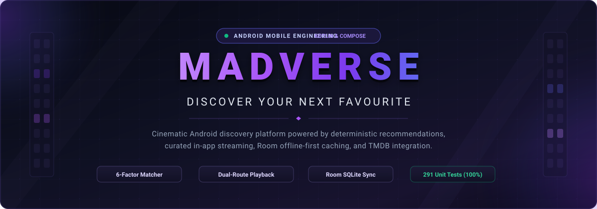
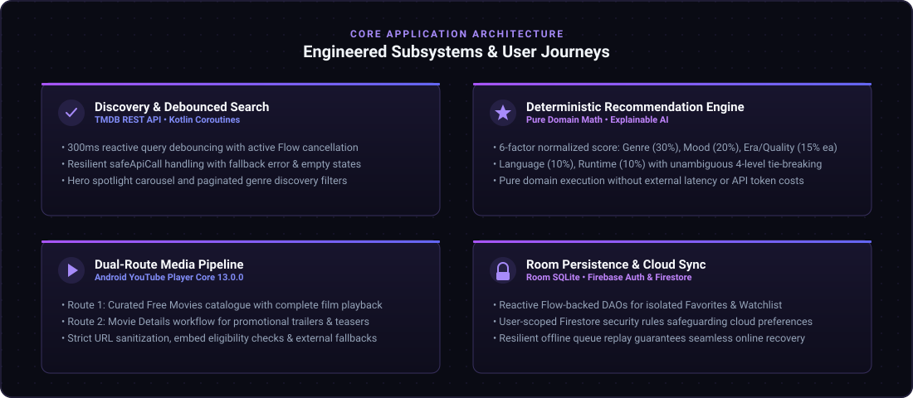
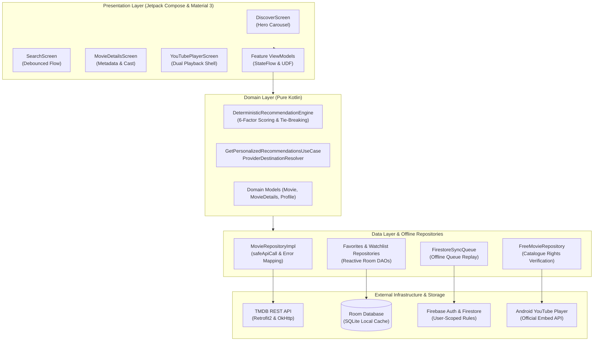

<p align="center">
  
</p>

<p align="center">
  <a href="https://kotlinlang.org/"></a>
  <a href="https://developer.android.com/jetpack/compose"></a>
  <a href="https://dagger.dev/hilt/"></a>
  <a href="https://developer.android.com/training/data-storage/room"></a>
  <a href="https://firebase.google.com/"></a>
  <a href="#test-validation--project-status"></a>
</p>

<p align="center">
  <a href="#overview">Overview</a> •
  <a href="#core-capabilities">Capabilities</a> •
  <a href="#system-architecture">Architecture</a> •
  <a href="#engineering-contributions">Engineering Contributions</a> •
  <a href="#technology-stack">Tech Stack</a> •
  <a href="#quick-start">Quick Start</a>
</p>

---

## Overview

**MADVerse** is an offline-first Android entertainment client combining cinema discovery, explainable personalization, and in-app streaming. Built with Jetpack Compose, Clean Architecture, Hilt, Room, and Firebase, MADVerse pairs TMDB-powered discovery with a deterministic local recommendation engine and dual media playback pipelines.

<p align="center">
  
</p>

---

## Core Capabilities

* **Discovery & Reactive Search:** Instant title browsing with 400ms debounced search queries and active coroutine flow cancellation to eliminate redundant network overhead.
* **Deterministic Recommendation Engine:** A transparent 6-factor scoring model (Genre 30%, Mood 20%, Era 15%, Quality 15%, Language 10%, Runtime 10%) providing match percentages and explainable chips locally without external AI latency or costs.
* **Dual-Route Media Playback:** Two distinct media workflows with ID sanitization and playback eligibility checks:
  1. *Curated Free Movies:* Catalogue-driven routing (`free_movie/{catalogueId}`) for in-app playback of curated complete-film entries; live availability and playback require device verification.
  2. *Trailers & Teasers:* Movie-details routing (`youtube_player/{videoId}`) for in-app promotional media playback.
* **Offline-First Persistence & Sync:** Room SQLite serves as the single source of truth for isolated Favorites and Watchlist collections, synchronized to user-scoped Firestore documents with offline queue replay.
* **Comparison & Regional Availability:** Three-way side-by-side spec comparisons with real-time watch providers defaulting to India (`IN`) with region fallback controls.

---

## System Architecture

MADVerse enforces unidirectional data flow (UDF) across Clean Architecture layers to isolate domain logic from platform frameworks.



### Key Engineering Decisions

* **Deterministic Scoring & Stable Tie-Breaking:** Recommendation rankings execute purely via mathematical scoring with 4-tier tie-breaking (`voteAverage` &rarr; `voteCount` &rarr; `popularity` &rarr; `id`), guaranteeing identical rankings for identical preference states.
* **Media Workflow Isolation:** Complete film catalogue playback and promotional trailers use separate navigation arguments and validation contracts, preventing unauthorized embeds while preserving user controls and browser fallbacks.
* **User-Scoped Security & Resilient Sync:** Cloud Firestore security rules restrict document access to authenticated owners (`request.auth.uid == userId`) with schema validation, backed by an offline queue replay mechanism.

---

## Engineering Contributions

> Grounded in 50 lead architect commits on `main` by **Ritunjay Deo**. Team members contributed shared design polish and comparative tooling ([Saanvi Chandel](docs/UI_UX_POLISH_PASS.md)) as well as Room entity implementations, library UI, and taste quiz views ([Shraddha Chandgothia](docs/CONTRIBUTION_EVIDENCE.md)).

* **Architecture & Repository Foundation:** Designed the multi-tier Clean Architecture foundation, Hilt dependency injection graphs, and network infrastructure utilizing Retrofit, OkHttp, and a credential-safe `AuthInterceptor`.
* **Deterministic Recommendation Engine:** Engineered the 6-factor mathematical scoring algorithm, stable tie-breaking logic, deduplication rules, and the `GetPersonalizedRecommendationsUseCase` domain pipeline.
* **Resilient Networking & Search Debouncing:** Implemented the `safeApiCall` coroutine error boundary and built search with 400ms query debouncing and automatic coroutine job cancellation on rapid keystrokes.
* **Firebase Auth & Cloud Personalization:** Integrated Firebase Authentication (Credential Manager Google Sign-In) and authored production Firestore security rules (`firestore.rules`) enforcing user-scoped read/write isolation.
* **Concurrency & Race Condition Hardening:** Resolved movie switch race conditions, synchronized parallel repository requests, and eliminated UI flickers across screen transitions.
* **Comprehensive Test Suite:** Authored automated unit test suites covering end-to-end user journeys, domain scoring, network mapping, and ViewModel state transitions—driving the test suite to 291 passing unit tests with 100% success.

---

## Technology Stack

| Domain | Technologies & Libraries |
| :--- | :--- |
| **Android & UI** | Kotlin 2.2, Jetpack Compose, Material 3, Navigation Compose, Coil Compose |
| **Architecture** | MVVM, Clean Architecture, Unidirectional Data Flow, Coroutines & StateFlow, Hilt (Dagger) |
| **Networking & Data** | Retrofit 2, OkHttp 4, Gson Converter, TMDB REST API, Safe Error Handlers |
| **Persistence & Cloud** | Room Database (SQLite), Flow DAOs, Firebase Auth, Cloud Firestore, Credential Manager |
| **Media & Playback** | Android YouTube Player Core 13.0.0, YouTube URL Sanitizer, Direct Deep Links |
| **Testing & Build** | JUnit 4, Kotlinx Coroutines Test, AndroidX Test, AGP 9.4.1, Gradle 9.6 |

---

## Quick Start

### Prerequisites
* **Android Studio** Ladybug / Iguana or later with **JDK 17**
* **Android SDK 37** (Minimum API 24)

### Setup & Validation

1. **Clone the repository:**
   ```bash
   git clone https://github.com/AkkiSensei/Mobile-Application-Development-Project.git
   cd Mobile-Application-Development-Project
   ```

2. **Configure API credentials safely:**
   Copy `local.properties.example` to `local.properties` (git-ignored) and insert your TMDB API key:
   ```properties
   TMDB_API_KEY=your_tmdb_api_key_here
   ```
   *(Gemini API key is reserved for optional experimental extensions; local recommendations run entirely offline).*

3. **Execute unit tests:**
   ```bash
   ./gradlew testDebugUnitTest
   ```

4. **Build debug APK:**
   ```bash
   ./gradlew assembleDebug
   ```
   Outputs to `app/build/outputs/apk/debug/app-debug.apk`.

---

## Test Validation & Project Status

* **Validation evidence:** See the [Shraddha Prompt 5 handoff](docs/handoffs/SHRADDHA_PROMPT_05_RITUNJAY_HANDOFF.md) for executed JVM, emulator, build and lint results, repaired regressions, and remaining acceptance checks. Fake-service tests do not establish live Firebase behavior. Galaxy A13 playback, campus Wi-Fi, live account deletion and full accessibility acceptance remain pending.
* **Media Limitations:** In-app video playback requires an active internet connection and relies on third-party YouTube API availability and publisher permissions.
* **TMDB Attribution:** This product uses the TMDB API but is not endorsed or certified by TMDB. Regional streaming provider data is supplied via JustWatch attribution and serves as informational guidance rather than a viewing entitlement.
